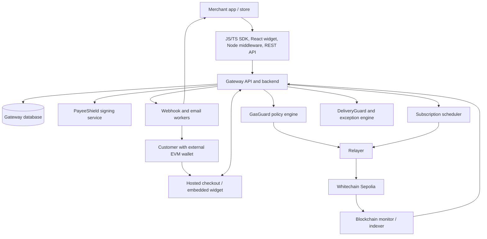
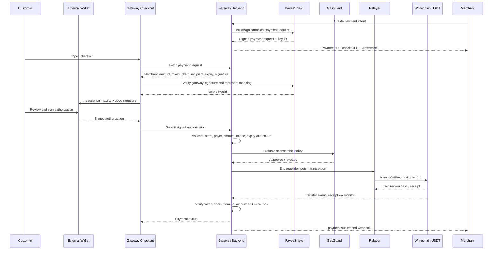

# EzPayz — End-to-End Flow

**Version:** 1.0  
**Date:** 30 October 2026  
**Status:** Flow decisions incorporated; technical dependencies listed for verification  
**Related document:** `WHITECHAIN_PAYMENT_GATEWAY_PRD.md`  
**Product:** General-purpose, non-custodial USDT payment gateway on Whitechain

---

## 1. Product operating model

The product is a general-purpose payment gateway for businesses, comparable in product shape to Stripe or Razorpay, but using USDT settlement on Whitechain.

A merchant integrates once and can use the same gateway for:

- One-time checkout.
- Fixed-amount, customer-entered-amount and reusable payment links.
- QR codes that open hosted checkout.
- Payment records and paid receipts.
- Full and partial refunds.
- Hourly, daily and monthly subscriptions.
- Metered/usage-based billing within an explicitly authorized spending limit.
- Merchant webhooks, customer records, transaction history and analytics.

The gateway is non-custodial for payment funds. In the normal one-time and subscription flows, USDT moves directly from the payer's wallet to the merchant's configured payout wallet. The gateway does not pool or hold customer payment funds. A refund is a separate transfer from the merchant's wallet to the original payer.

The platform operates shared infrastructure: merchant accounts, payment intents, checkout, transaction verification, receipts, webhooks, refunds, subscription scheduling, relayer operations, customer records and reporting.

### 1.1 Confirmed architecture decisions

| Area | Confirmed decision |
|---|---|
| Network for the hackathon | Whitechain Sepolia, chain ID `1874` |
| Asset for the required demo | ETHGlobal-specified test USDT at `0xcedfB56113143d55b2358b8CFbB0dEB5Ad2f55a` |
| Payer wallet | Connected external wallet, such as MetaMask or another compatible EVM wallet |
| One-time payment authorization | EIP-3009 `transferWithAuthorization` + gateway relayer, subject to exact token compatibility |
| One-time payment settlement | Directly from payer to merchant payout wallet |
| One-time payment gas | Gateway relayer pays WBT gas |
| Subscription authorization | Customer grants a capped ERC-20 allowance to the subscription contract |
| Subscription execution | Backend scheduler triggers relayer; relayer calls the subscription contract; contract uses `transferFrom` directly to merchant |
| Subscription initial approval/activation gas | Customer normally pays WBT gas |
| Subscription cancellation | Customer submits on-chain cancellation and normally pays WBT gas; allowance revocation is a separate transaction |
| Refunds | Merchant-authorized transfer back to payer; gateway relayer sponsors gas where token authorization permits |
| PayeeShield signing | Gateway-managed delegated signing mechanism, not a merchant's wallet signing every invoice |
| Receipts | Paid receipt is emailed after successful payment; no automatic email for an unpaid request is assumed in this flow |
| Payment links | Fixed amount, customer-entered amount and reusable links |
| Renewal failures | Merchant-configurable retry policy, within customer authorization and contract limits |
| SDK / integration | JavaScript/TypeScript npm SDK, React checkout widget, Node.js backend middleware, REST APIs and webhooks |
| Scope | Every agreed MVP feature is intended to work in the hackathon MVP; future features are separated below |

### 1.2 Important product boundary

The selected external-wallet experience means a customer needs a compatible wallet and USDT. The gateway can hide WBT gas and most chain details, and can prompt the wallet to switch to Whitechain Sepolia, but it cannot honestly claim that an external-wallet flow requires no wallet or no crypto familiarity at all. A fully embedded, email/social-login wallet experience is not part of the currently confirmed MVP.

---

## 2. Actors and responsibilities

| Actor/component | Responsibilities |
|---|---|
| Merchant | Registers a payout wallet, creates products/payment requests, configures subscriptions, receives USDT, authorizes refunds and manages fulfilment |
| Merchant developer | Integrates SDK/widget/API, handles server-side webhooks and grants access to paid goods/services |
| Payer/customer | Connects an external wallet, reviews payment details, signs an EIP-3009 authorization or grants subscription allowance, and manages cancellation |
| Gateway frontend | Merchant dashboard, hosted checkout, customer-facing payment status and subscription-management screens |
| Gateway API/backend | Merchant authentication, payment intents, checkout sessions, invoice records, subscription state, refunds, customer records, policy checks and orchestration |
| PayeeShield signer | Signs canonical payment-request/invoice payloads using gateway-managed delegated signing keys |
| Relayer | Submits approved EIP-3009 authorizations, subscription execution calls and eligible refund authorizations; pays WBT gas |
| GasGuard | Applies relayer allowlists, limits, budgets, rate controls, signature/expiry checks and transaction policies |
| Subscription contract | Enforces on-chain subscription status, interval, per-cycle cap, cumulative cap, expiry, cancellation and transferFrom execution |
| Blockchain monitor | Reads transactions/events, verifies the exact chain/token/addresses/amounts, and updates settlement states |
| Scheduler/worker | Finds due subscription renewals, applies merchant retry policy and enqueues idempotent execution jobs |
| Email service | Sends paid receipts and refund/renewal notifications according to configured templates |
| Webhook service | Signs, delivers, retries and records merchant webhook events |
| DeliveryGuard | Tracks merchant-reported fulfilment states associated with a successful payment |
| Exception service | Detects, classifies and helps resolve underpayments, overpayments, duplicates, expired requests, reverted transactions and delivery failures |

---

## 3. High-level architecture



The backend is the orchestration layer; Whitechain is the settlement and authorization-enforcement layer. The browser is never the authority for payment success. The blockchain monitor and verified chain data determine whether a payment settled.

For the hackathon, this architecture can be implemented as a modular monolith with background workers rather than many separately deployed microservices.

---

## 4. Merchant onboarding and setup flow

### 4.1 Account creation

1. Merchant creates a gateway account.
2. Gateway creates an isolated merchant workspace and merchant ID.
3. Merchant configures their business display name, support email and allowed origin/domain(s).
4. Merchant connects or registers a Whitechain payout wallet.
5. Gateway verifies wallet control using a wallet signature or a small, clearly specified wallet-verification flow. This is wallet-control verification, not legal business/KYC verification.
6. Merchant selects the test environment and the supported USDT asset.
7. Gateway stores the merchant's payout wallet, token/network configuration and account settings.

### 4.2 Developer setup

1. Merchant creates a test API key and secret API key.
2. Gateway displays the secret once and stores only a secure hash or protected secret representation.
3. Merchant configures a webhook endpoint.
4. Gateway creates a webhook signing secret and displays it once.
5. Merchant installs the JavaScript/TypeScript npm package and configures the secret key only in their server environment.
6. Merchant adds the React checkout widget to their frontend and a Node.js middleware/API integration to their backend.
7. Merchant tests a payment in the test environment.

**Credential boundary:** Secret API keys, relayer private keys and PayeeShield signing keys must never be exposed to browser code. Browser-facing code receives only public/publishable identifiers and short-lived checkout/session data.

### 4.3 Merchant products and payment configuration

The merchant may configure:

- Products/services and descriptions.
- One-time prices.
- Subscription plans, interval, per-cycle maximum and cumulative spending limit.
- Payment-link rules: fixed amount, customer-entered amount with configured minimum/maximum, or reusable link.
- Receipt email preferences.
- Webhook event subscriptions.
- Merchant refund policy and DeliveryGuard status labels.

---

## 5. Developer integration flow

The intended integration is approximately 20 lines for a basic checkout, with the developer's secret API key held on the server.

### 5.1 Basic integration sequence

1. Developer installs `@whitechain-pay/sdk`.
2. Developer initializes the SDK in a Node.js backend using a server-side secret key.
3. Merchant backend calls the gateway to create a payment intent.
4. Gateway returns a payment ID and a client-safe checkout reference/URL.
5. Frontend renders the React checkout widget with that reference.
6. Customer completes the payment in hosted checkout/widget.
7. Gateway verifies settlement and delivers a signed webhook to the merchant backend.
8. Merchant backend verifies the webhook signature and processes it idempotently.

Illustrative shape only; exact package names and method signatures are implementation decisions:

```ts
// Server-side only
const payment = await gateway.paymentIntents.create({
  amount: "10.00",
  currency: "USDT",
  description: "Premium plan"
});

// Client-side: no secret API key
<WhitechainCheckout checkoutId={payment.checkoutId} />
```

### 5.2 Developer responsibilities

The gateway handles payment creation, authorization flow, relaying, settlement monitoring and webhook delivery. The merchant remains responsible for granting the purchased product/service after receiving and verifying `payment.succeeded`, applying its own access-control rules and handling fulfilment.

---

## 6. One-time USDT checkout flow

This is the primary payment path and the path that must demonstrate a real test-USDT settlement on Whitechain Sepolia.

### 6.1 Sequence overview



### 6.2 Payment-intent creation

1. Customer selects a product or service on the merchant's website.
2. Merchant backend creates a payment intent through the SDK/REST API.
3. Gateway authenticates the merchant and validates the amount, token, chain, payout wallet, description and idempotency key.
4. Gateway creates a unique payment intent and checkout session.
5. Gateway records the expected payer/payment parameters and expiration policy.
6. PayeeShield signs the canonical payment request using the gateway-managed delegated signing mechanism described in Section 9.
7. Gateway returns a client-safe checkout reference or hosted checkout URL.

The payment intent is not considered paid at this stage.

### 6.3 Customer checkout and wallet connection

1. Customer opens the hosted checkout or React widget.
2. Checkout displays merchant name, product/description, amount, USDT token, Whitechain network, payout destination/verified merchant details and expiry.
3. Customer connects MetaMask or another compatible external EVM wallet.
4. Checkout checks the connected chain and requests a network switch to Whitechain Sepolia if required.
5. Checkout verifies the payer's USDT balance is sufficient for the payment.
6. PayeeShield validates the signed payment request and compares displayed values with the canonical payload.
7. If the signature is invalid, revoked, expired or the protected values do not match, checkout blocks the payment.

The app must never request or collect a seed phrase or private key.

### 6.4 EIP-3009 authorization

1. Checkout prepares an EIP-712 `TransferWithAuthorization` typed message using the exact token contract's domain and the payment intent's values.
2. The signed authorization binds at least:
   - `from`: customer wallet.
   - `to`: merchant payout wallet.
   - `value`: exact USDT amount in token base units.
   - `validAfter` and `validBefore`: authorization validity window.
   - `nonce`: unique authorization nonce.
   - EIP-712 domain: correct chain ID and verifying token contract, as required by the token implementation.
3. Wallet displays the typed-data signing request; customer reviews and signs it.
4. The wallet returns the signature to checkout.
5. Checkout submits the signature and payment reference to the gateway backend over HTTPS.
6. Backend validates the signature against the connected/claimed payer and exact payment intent. It checks amount, recipient, token, chain, expiry, nonce/replay state and payment status.
7. Backend rejects stale, duplicated, mismatched or already-consumed authorizations.

This is a signature authorization, not a customer-paid blockchain transaction. The gateway relayer pays the transaction gas when submitting it.

### 6.5 GasGuard and relayer submission

Before submission, GasGuard checks:

- The merchant is active and permitted to sponsor payments.
- The token contract and network are allowlisted.
- The destination is the merchant's configured payout wallet for this intent.
- The amount is within per-payment and merchant sponsorship limits.
- The signature and validity window are acceptable.
- The authorization nonce/payment intent has not already been used.
- Merchant and global gas budgets have capacity.
- Request rate, payer rate and relayer queue limits are not exceeded.
- The relayer's WBT balance is above its operational minimum.

If approved:

1. Backend enqueues a transaction with an idempotency key.
2. Relayer signs and submits `transferWithAuthorization` to the USDT contract.
3. Relayer pays WBT gas.
4. Relayer stores the transaction hash and submission metadata.
5. If submission is ambiguous due to timeout, the system checks chain state and authorization state before retrying; it must not blindly submit a duplicate.

If rejected, no transaction is sent and the customer receives an actionable error.

### 6.6 Settlement verification

A transaction hash alone does not equal a successful payment. The blockchain monitor verifies:

- Correct Whitechain network/chain ID.
- Correct USDT contract address.
- Successful transaction receipt/status.
- Expected token `Transfer` event.
- `from` equals the payer.
- `to` equals the merchant payout wallet.
- Amount equals the expected base-unit amount.
- Payment intent and authorization have not already been settled/consumed.

Only after the configured settlement policy is met does the gateway mark the payment `succeeded`.

The implementation must define whether customer-facing status is based on L2 inclusion/soft confirmation or a stronger/finalized state. The gateway may expose separate `processing`, `confirmed` and `finalized` states so the merchant can choose when to fulfil higher-value orders. Do not claim that a transaction is fully final merely because a transaction hash was returned.

### 6.7 Post-payment actions

After verified settlement:

1. Payment record becomes `succeeded`.
2. Merchant dashboard updates.
3. Gateway creates/updates the customer record within that merchant's isolated workspace.
4. Gateway creates the paid receipt/invoice record.
5. Gateway sends the customer a paid receipt email if an email address was supplied and email delivery is enabled.
6. Gateway emits `payment.succeeded` to the merchant's webhook endpoint.
7. DeliveryGuard creates or updates the fulfilment record.
8. Transaction hash and explorer URL appear in the merchant dashboard and receipt.

Email delivery and webhook delivery are independent of settlement. A failed email or webhook must not reverse or downgrade a successful payment.

---

## 7. Payment links and QR payment flows

All link and QR payments use the same payment-intent, PayeeShield, checkout, EIP-3009, relayer and settlement pipeline described in Section 6.

### 7.1 Fixed-amount link

1. Merchant creates a link with fixed amount, description, expiry and optional reference/order ID.
2. Gateway stores link configuration and creates a hosted URL.
3. QR code encodes the hosted URL, not a raw transfer instruction.
4. Customer opens/scans it.
5. Gateway creates or resolves a payment intent for that checkout attempt.
6. Customer pays through the standard one-time flow.

### 7.2 Customer-entered-amount link

1. Merchant creates a link with an allowed minimum and maximum amount, plus optional description/reference.
2. Customer opens the link and enters an amount within the permitted range.
3. Backend validates the amount and creates a payment intent.
4. PayeeShield signs the exact chosen amount and recipient details.
5. Customer completes the standard checkout flow.

Do not allow zero, negative, out-of-range or malformed amounts. Use integer/base-unit arithmetic.

### 7.3 Reusable link

A reusable link remains active until the merchant disables it or its configured expiry is reached. Each successful customer checkout creates a separate payment intent and separate settlement record. The link itself is not a shared payment authorization and does not permit a customer to pay another customer's intent.

### 7.4 Link controls

The merchant can inspect, copy, disable and expire links. Each link should have a unique ID, merchant ownership, amount policy, expiry, allowed token/network, optional usage constraints and a status. QR codes must resolve to the same protected hosted-checkout URL.

---

## 8. Invoice and paid-receipt flow

1. Merchant creates a payment request/invoice record through the dashboard or API.
2. Gateway assigns an invoice ID and associates it with a payment intent or payment link.
3. Gateway generates the canonical invoice payload and signs it through PayeeShield.
4. Customer pays via checkout.
5. After settlement, gateway marks the invoice `paid` and creates the paid receipt.
6. Gateway emails the paid receipt to the customer, if an email address is available and email delivery is configured.
7. Merchant can view/download the receipt from the dashboard.

The confirmed email choice is **B: email the paid receipt after successful payment**. This flow does not assume that an unpaid invoice/request is automatically emailed. Any future pre-payment invoice email/reminder feature must be explicitly added to scope.

---

## 9. PayeeShield — gateway-managed delegated invoice signing

### 9.1 Purpose

PayeeShield protects payment requests against amount, token, chain, invoice-ID or payout-address tampering. The chosen design is a gateway-managed delegated signing mechanism; merchants do not need to sign each invoice from their payout wallet.

### 9.2 Proposed key model

- Gateway provisions a dedicated signing key or isolated key handle per merchant, held in a managed KMS/HSM or equivalent protected signing service.
- The key is scoped to invoice/payment-request attestation only. It must not be used as a token-spending key, merchant payout key or relayer key.
- Merchant onboarding and API terms explicitly authorize the gateway to issue signed payment requests on the merchant's behalf.
- Every signed invoice includes a key ID so the checkout can resolve the corresponding public key and check its status.
- Gateway maintains key rotation, revocation and audit logs.
- If a merchant is suspended or revokes delegated signing, new payment requests must not be signed with the old key.

A single unrestricted platform-wide private key is not the preferred design. Per-merchant key isolation limits the impact of a key compromise and supports merchant-specific revocation.

### 9.3 Canonical signed payload

The signed payload should bind at least:

- Schema/version.
- Merchant ID.
- Invoice/payment-request ID.
- Merchant display identity/domain reference.
- Payout wallet address.
- Chain ID.
- Token contract address and currency symbol/decimals metadata.
- Exact amount in token base units.
- Description/order reference where relevant.
- Created time and expiry.
- Unique nonce.
- Key ID.

### 9.4 Customer verification

1. Checkout retrieves the signed payload.
2. Checkout resolves the correct gateway public key from the key ID.
3. Checkout verifies signature, key status, expiry and nonce.
4. Checkout compares every protected field with the values it is about to authorize.
5. Any mismatch blocks payment and displays a clear warning.

### 9.5 Trust limitation

A valid gateway signature proves that the request was signed by the gateway's delegated key for the merchant account. It does not independently prove that the business is legally real, that the merchant will deliver goods, or that the merchant's account has not been compromised. Gateway-managed signing also makes the gateway a trusted issuer of payment requests; its key-management and authorization controls are therefore critical.

---

## 10. Subscription and automatic recurring billing flow

Subscriptions use a separate authorization model from one-time EIP-3009 payments.

### 10.1 Merchant creates a plan

Merchant configures:

- Plan name and description.
- Billing interval: hourly, daily or monthly (with defined time-zone/calendar semantics).
- Charge amount or usage-based pricing formula.
- Maximum charge per billing cycle.
- Cumulative spending limit.
- Subscription expiry/end date.
- Retry policy (number of attempts, retry intervals/backoff and final failure state).
- Optional grace period and customer notification settings.

The customer-facing plan details must match the contract parameters. Merchant configuration cannot override a customer's existing authorization.

### 10.2 Customer authorizes subscription

1. Customer opens plan checkout with a connected external wallet.
2. Checkout displays amount, interval, maximum per cycle, cumulative spending limit, expiry, retry implications and cancellation method.
3. Customer explicitly agrees to recurring billing.
4. Customer submits an ERC-20 `approve(subscriptionContract, allowanceAmount)` transaction on Whitechain Sepolia.
5. Customer pays WBT gas for this initial approval under the confirmed MVP architecture.
6. Customer submits the subscription activation/creation transaction to the subscription contract, normally paying WBT gas.
7. Contract records customer, merchant payout wallet, plan/subscription ID, amount or usage rule, interval, per-cycle cap, cumulative cap, total spent, expiry, next due time and active status.
8. Backend stores a mirrored subscription record and monitors the on-chain activation event.

The token allowance should be capped to the amount the customer has authorized, not unlimited. The subscription contract must additionally enforce each subscription's on-chain limits. ERC-20 allowance is generally granted to a spender contract for an owner; it is not itself a complete per-subscription policy engine.

### 10.3 Renewal scheduler and relayer execution

1. Scheduler queries active subscriptions whose next billing time is due.
2. Scheduler creates a unique renewal job for `(subscriptionId, billingSequence)`.
3. Backend checks subscription mirror state, current on-chain state, merchant retry configuration, expiry and whether the cycle has already been processed.
4. GasGuard checks merchant sponsorship budgets, relayer balance, call allowlists and rate limits.
5. Relayer calls the subscription contract's renewal/charge function.
6. Contract independently validates:
   - Subscription is active and not cancelled.
   - Current time is within the permitted billing window.
   - This billing sequence has not already been charged.
   - Charge is no greater than the per-cycle cap.
   - Cumulative spend after this charge will not exceed the authorized total cap.
   - Subscription has not expired.
   - Merchant recipient is the stored/authorized recipient.
   - Token and amount satisfy configured rules.
7. Contract calls `USDT.transferFrom(customer, merchant, amount)`.
8. Contract updates spent amount, last/next billing time and cycle state as part of the same successful transaction.
9. Relayer pays WBT gas.
10. Blockchain monitor verifies the contract event and token transfer.
11. Backend updates renewal status and sends `subscription.renewed` or the corresponding failure event.
12. Paid receipt/renewal confirmation email is sent if configured.

The subscription contract is the final enforcement point. The backend scheduler is not trusted to enforce spending limits by itself.

### 10.4 Usage-based billing

1. Merchant backend reports usage events to the gateway with an idempotency key and authenticated merchant credentials.
2. Gateway validates the event, customer/subscription association and metering policy.
3. Gateway aggregates billable usage for the billing period.
4. Gateway calculates the requested charge using integer/base-unit arithmetic and the agreed pricing rule.
5. The requested charge must remain within the customer's per-cycle and cumulative authorized limits.
6. Scheduler requests the contract renewal/charge function.
7. If the amount exceeds the remaining authorization, no transfer is attempted; the merchant/customer must request a new authorization or apply the agreed non-payment behavior.

Usage records are provided by the merchant's application. The gateway records and bills them but does not independently prove that every reported API call or unit of service occurred.

### 10.5 Renewal failure and retry policy

The merchant can configure a retry policy, but it cannot exceed or bypass the customer's signed/approved authorization.

- A failed on-chain charge must not increment `totalSpent` or mark a cycle as paid.
- A retry uses the same logical billing-cycle identifier and must be idempotent.
- The backend classifies the failure (e.g. insufficient balance, allowance exhausted, expired authorization, cancelled subscription, RPC/relayer failure or reverted contract call).
- Retryable infrastructure errors may be retried according to bounded backoff.
- Insufficient funds/allowance should trigger customer notification and follow the merchant's configured retry policy.
- No retry may charge more than the original due amount or bypass contract caps.
- The system must define what happens to a missed cycle: retry the same cycle, skip it, or terminate/pause after the configured maximum attempts. It must never silently accumulate multiple unexpected charges.
- A successful renewal advances the billing sequence exactly once.

### 10.6 Cancellation and allowance revocation

1. Customer opens subscription management.
2. Customer selects Cancel.
3. Wallet submits a call to the subscription contract to cancel the subscription.
4. Customer normally pays WBT gas for this transaction in the MVP.
5. Contract marks the subscription cancelled immediately and prevents any future charge for it.
6. Backend observes the cancellation event and stops scheduling future renewals.
7. Customer is advised to separately revoke any remaining ERC-20 allowance to the subscription contract, usually by approving zero and paying WBT gas.
8. Backend updates dashboard and sends cancellation confirmation.

Cancellation and allowance revocation are distinct. Cancellation disables the subscription's authorization logic; allowance revocation reduces the remaining token permission at the ERC-20 level. The UX must explain both actions. The contract must not rely solely on the backend scheduler to stop charges.

### 10.7 Allowance model risk to resolve

ERC-20 allowance is typically shared by owner and spender contract, not naturally isolated by subscription ID. If one subscription contract is the spender for multiple subscriptions from the same customer, the contract must enforce per-subscription and cumulative limits internally and prevent one subscription from consuming another's intended budget. The team must choose and test either a carefully bounded shared allowance model or isolated spender/deployment architecture. Do not grant unlimited allowance for convenience.

---

## 11. Refund flow

### 11.1 Refund eligibility and amount accounting

1. Merchant opens a successful payment.
2. Gateway displays original amount, payer address, merchant payout wallet and previous refunds.
3. Merchant selects full or partial refund and enters an amount/reason.
4. Backend verifies that the payment settled, refund amount is positive and cumulative refunds will not exceed the original successful payment amount.
5. Backend creates a refund record with a unique ID and idempotency key.

### 11.2 Gas-sponsored refund where supported

1. Merchant reviews and authorizes the refund using the connected merchant wallet.
2. If the exact token supports EIP-3009, merchant signs a `TransferWithAuthorization` from the merchant payout wallet to the original payer for the exact refund amount.
3. Backend validates merchant identity, recipient, amount, token, chain, nonce, validity window and refund eligibility.
4. GasGuard checks refund sponsorship policy and budget.
5. Relayer submits the authorization and pays WBT gas.
6. Blockchain monitor verifies the USDT transfer from merchant to original payer.
7. Refund status changes to `succeeded` only after verified settlement.

### 11.3 Fallback where authorization is unsupported

If the token does not support a suitable authorization method, the merchant submits a normal USDT transfer from the merchant wallet and pays WBT gas. The gateway monitors and reconciles that transaction. The gateway must not claim that this fallback is gas-sponsored.

### 11.4 Refund notifications

After verified settlement:

- Dashboard displays the refund and transaction hash.
- Gateway emits `refund.succeeded` webhook.
- Customer receives a refund confirmation if email is available.
- Original payment shows the cumulative refunded and remaining refundable amount.

Refunds are not reversals. The merchant must hold enough USDT in the payout wallet to fund the refund. Gateway does not guarantee merchant liquidity.

---

## 12. DeliveryGuard flow

DeliveryGuard is a fulfilment tracker, not escrow and not automatic dispute adjudication.

1. Payment is verified as successful.
2. Gateway creates a fulfilment record linked to the payment/order.
3. Merchant updates fulfilment state through dashboard/API: `not_started`, `processing`, `fulfilled`, `cancelled`, `return_requested`, `refund_initiated` or `refunded`.
4. Merchant may attach a tracking number, completion URL or reference/evidence metadata.
5. Customer can view permitted order status through a protected customer link/receipt.
6. Status changes are recorded with timestamps and actor identity.
7. If a refund is needed, merchant starts the separate refund flow in Section 11.

The MVP records merchant-provided updates. It must not claim independent proof of physical delivery or hold/release funds based on fulfilment status.

---

## 13. Payment Exception Intelligence

The exception engine continuously reconciles gateway records with chain state and classifies operational problems.

| Exception | Detection and handling |
|---|---|
| Underpayment | Compare verified token transfer amount with payment intent; mark underpaid and request merchant decision |
| Overpayment | Record excess amount separately; alert merchant; no automatic refund without merchant authorization |
| Duplicate payment | Detect multiple valid transfers for one intent/customer/order; link them and alert merchant |
| Expired invoice paid | Record actual transfer; mark as late/exception for merchant review rather than pretending it did not happen |
| Reverted transaction | Mark attempt failed; retain revert/receipt details and allow safe retry with a new valid authorization where appropriate |
| Relayer timeout/unknown outcome | Query authorization state and chain receipt before retrying; do not blindly resubmit |
| Webhook delivery failure | Retry with bounded backoff; keep payment settlement status unchanged |
| Email delivery failure | Retry email; payment remains successful |
| Subscription insufficient balance/allowance | Mark renewal failed; apply merchant-configured retry policy and notify payer |
| Refund failed | Preserve refund as failed/pending; never mark refunded until verified transfer |
| RPC/indexer outage | Keep status pending/unknown and reconcile when data source recovers |

Each exception should have a reason code, supporting transaction/reference data, timestamps, recommended action and resolution audit trail. Human merchant review is required for ambiguous or overpaid/late-paid cases.

---

## 14. Webhook and notification lifecycle

### 14.1 Core webhook events

Suggested event types:

- `payment.created`
- `payment.processing`
- `payment.succeeded`
- `payment.failed`
- `payment.expired`
- `payment.exception`
- `refund.created`
- `refund.processing`
- `refund.succeeded`
- `refund.failed`
- `subscription.created`
- `subscription.renewal_due`
- `subscription.renewed`
- `subscription.payment_failed`
- `subscription.cancelled`
- `fulfillment.updated`

### 14.2 Delivery behavior

1. Backend commits the business-state change and corresponding event to a durable outbox.
2. Webhook worker loads the event and merchant endpoint.
3. Worker signs the payload using the merchant-specific webhook secret.
4. Worker sends the event with a unique event ID and timestamp.
5. Merchant verifies signature and timestamp, then handles the event idempotently.
6. Gateway records response, latency and attempt count.
7. Failed delivery is retried with bounded exponential backoff and jitter.
8. Merchant can inspect and manually replay eligible events.

Events may be delivered more than once and may arrive out of order. Merchant integrations must deduplicate by event ID and fetch the latest payment/subscription state from the API when ordering matters.

### 14.3 Email behavior

- Paid receipt email is sent after verified successful payment.
- Refund confirmation email is sent after verified refund settlement.
- Subscription renewal/cancellation/failure emails are sent according to merchant/customer notification settings.
- Email delivery failure is a notification exception, not a payment exception that reverses settlement.

---

## 15. Merchant dashboard flow

The dashboard is the control plane for the merchant.

| Dashboard area | Core flow |
|---|---|
| Overview | View USDT volume, successful payments, failed/pending payments, refunds and active subscriptions |
| Payments | Search/filter payments; inspect payer, amount, recipient, status, token, network and transaction hash |
| Payment links | Create fixed, customer-entered and reusable links; generate QR; disable/expire links |
| Products/services | Configure one-time offerings and subscription plans |
| Customers | View records scoped to this merchant only; inspect their payment/subscription history |
| Invoices/receipts | Inspect payment request and paid-receipt records; download/share receipt |
| Subscriptions | View active/cancelled/past-due subscriptions, limits, next charge, renewal attempts and cancellation state |
| Refunds | Start and track full/partial refunds |
| Fulfilment | Update and inspect DeliveryGuard records |
| Exceptions | Review underpayments, overpayments, duplicates, late payments, reverted transactions and notification problems |
| Developers | Manage API keys, webhook endpoints, event logs and SDK documentation |
| Settings | Manage payout wallet, business display details, receipt preferences, signer delegation status and API environment |

Customer data, invoices and transactions must be scoped by `merchant_id` on every backend query and authorization check. Client-side filtering alone is not an isolation mechanism.

---

## 16. Relayer, GasGuard and operational funding

The gateway operates a relayer funded with WBT. It pays gas for:

- One-time EIP-3009 payment submissions.
- Automatic subscription renewal calls.
- Eligible merchant-authorized refunds where the token authorization method supports relayer submission.

The customer normally pays gas for:

- Initial subscription token allowance approval.
- Subscription activation/creation.
- Subscription cancellation.
- Separate ERC-20 allowance revocation.

### 16.1 GasGuard controls

- Token and chain allowlists.
- Merchant allowlist and account status checks.
- Recipient must match the merchant payout address/payment authorization.
- Per-transaction maximum amount.
- Per-merchant transaction and daily/period gas budgets.
- Global WBT spend budget and emergency stop.
- Per-payer, per-merchant and global request rate limits.
- Validity-window and nonce checks.
- Idempotent job IDs and duplicate-submission protection.
- Relayer WBT low-balance alerts and controlled refill process.
- Transaction queue monitoring, failure classification and audit logs.
- Administrative pause/recovery procedure.

The relayer private key must be stored in a secrets manager/KMS or similarly protected signing environment, not in source code, frontend configuration or ordinary logs. Access should be least-privilege and audited.

---

## 17. Future integrations and capabilities — not MVP dependencies

These are intentionally separate from the MVP. The core gateway must work without any of them.

| Future item | Potential role | Dependency before implementation |
|---|---|---|
| x402 | Standardized programmatic payment requests for API/software clients | Compatible x402 scheme, facilitator implementation, exact Whitechain/token support and security review |
| Arkiv | Searchable merchant registry, expiring offers and selected invoice metadata | Data schema, write/query integration, public-vs-private data model and lifecycle/expiry semantics |
| Chainlink CRE | Payment-triggered workflows to external merchant systems | Supported Whitechain integration, CRE workflow design and authenticated external API model |
| WhiteBIT | USDT conversion/off-ramp and fiat withdrawal | Confirmed direct deposit support for the exact Whitechain USDT network/contract, API/business access, jurisdiction and settlement eligibility |
| EzPayz | Potential interoperability | Public/partner API availability and a specific non-duplicative use case |
| Multi-chain | Accept assets on additional networks | Per-network token verification, routing, confirmation semantics and risk policy |
| API/service marketplace | Discoverable paid APIs/services | Marketplace supply, discovery/indexing, pricing/metadata standards and possibly x402 |
| Enterprise B2B | Reconciliation, vendor controls, approvals and accounting exports | Merchant demand, roles/approvals, auditability and accounting integration requirements |
| Embedded wallets | Hide wallet setup and chain interaction further | Provider supports Whitechain Sepolia, signing model and recovery/custody/security decisions |

---

## 18. Critical technical dependencies and release gates

The following items must be verified before implementation claims or final demo assumptions are made. An item marked **unverified** is not an assertion that the capability is absent; it means the team has not yet supplied proof of compatibility.

### P0 — Must verify before the core demo

| Dependency | Why it matters | Verification/action | Failure impact |
|---|---|---|---|
| Exact test USDT supports EIP-3009 | One-time gasless checkout and relayer-sponsored refunds depend on the token implementing the required methods and EIP-712 domain/signature behavior | Inspect verified source/ABI; check method selectors and token domain; test a signed transfer from a funded test wallet; verify nonce/replay behavior | One-time EIP-3009 path cannot be implemented as selected; refund sponsorship may also be unavailable |
| Exact test USDT supports ERC-20 allowance flow | Subscription requires `approve`, `allowance` and `transferFrom` semantics | Inspect source/ABI and execute approve/allowance/transferFrom integration tests | Subscription architecture must be revised if unsupported or non-standard |
| Exact testnet configuration | Contracts and wallets must target Whitechain Sepolia | Confirm chain ID `1874`, RPC, explorer and faucet from current official docs immediately before deployment | Wrong-chain deployment or transaction failure |
| Required USDT address and decimals | ETHGlobal requires the specified token; amount calculation depends on decimals | Use the exact address from the prize rules; call `decimals`, `symbol`, `name` and `balanceOf`; do not assume decimals | Qualification failure or incorrect amounts |
| External wallet typed-data support | Customer must sign EIP-712 EIP-3009 data | Test MetaMask and at least one fallback EVM wallet; validate domain and chain-switch UX | Payer cannot authorize gasless payment |
| Relayer WBT funding and stability | Gateway pays gas for one-time payments, renewals and eligible refunds | Fund test relayer; estimate gas; add balance threshold/alerts; test insufficient relayer balance recovery | Sponsored flow unavailable or stuck |
| Settlement confirmation policy | Dashboard/webhooks must not report success prematurely | Verify Whitechain transaction lifecycle and define submitted/included/confirmed/finalized states | False success or delayed fulfilment |
| Merchant wallet signature and payout control | Refunds and merchant configuration must target the intended merchant wallet | Define wallet ownership verification and ensure payout wallet changes require fresh proof/approval | Misrouting or unauthorized refund risk |

### P0 — Contract and authorization safety

| Dependency | Why it matters | Required control/test |
|---|---|---|
| Subscription allowance architecture | ERC-20 allowance is per owner/spender, while limits are per subscription | Define shared vs isolated spender design; enforce per-subscription and aggregate caps on-chain; no unlimited allowance |
| Subscription contract authorization | Scheduler/relayer must not freely debit a customer | Contract checks active subscription, due interval, fixed/allowed merchant, per-cycle cap, cumulative cap, expiry and unique billing sequence |
| Subscription cancellation behavior | A cancelled subscription must never be charged again | On-chain cancellation must block future charge calls regardless of backend/scheduler state |
| Reentrancy and token interaction safety | Contract executes external token calls | Use checks-effects-interactions, reentrancy protection and safe ERC-20 wrappers; test adversarial/reverting token behavior |
| Replay and duplicate prevention | EIP-3009 authorization and renewal/refund jobs must not be executed twice | Nonce/authorization-state checks, idempotent payment/refund/cycle IDs and chain-state reconciliation |
| Relayer key custody | Relayer can spend gas and submit customer-authorized transfers | KMS/secrets manager, least privilege, audit, rotation, emergency pause and no key in client code |
| PayeeShield signing-key custody | Gateway-managed signing can attest invoice details | Per-merchant key isolation, KMS/HSM, key IDs, rotation/revocation, audit and explicit merchant delegation consent |

### P1 — Needed for a credible complete demo

| Dependency | Why it matters | Verification/action |
|---|---|---|
| Webhook durability | Merchant should not miss payment/refund events | Transactional outbox, signature verification, retries, idempotency and replay test |
| Payment/indexer reliability | UI and reconciliation depend on chain reads | Retry/backfill logic, independent receipt verification and RPC outage handling |
| Email provider | Paid receipts are part of the agreed flow | Configure sender/domain, test delivery and failure handling |
| Refund sponsorship | Merchant wants gateway-paid refund gas where permitted | Test merchant EIP-3009 typed-data authorization; otherwise show merchant-paid-gas fallback |
| Subscription retry semantics | Merchant-configurable retry must not cause duplicate or accumulated charges | Define max attempts/backoff, failed-cycle behavior, per-cycle idempotency and customer notifications |
| Customer-data isolation | Merchant can see only its own customers | Enforce tenant scope in every query/API; test cross-merchant access denial |
| Link behavior | Fixed, customer-entered and reusable links have different validation | Test min/max amount, expiry, disable state, one-payment vs reusable behavior and duplicate attempts |
| Browser/wallet compatibility | External-wallet flow is customer-facing | Test connection, chain switch, typed-data signature rejection, insufficient USDT and disconnected wallet cases |

### Important UX qualification

The selected external-wallet approach avoids asking the payer to pay WBT for a supported one-time payment, and the app must never ask for a seed phrase. However, the customer still needs a compatible wallet, USDT and to approve a typed-data signature. The checkout can hide chain complexity and request a network switch, but it cannot fully eliminate wallet interaction without a future embedded-wallet/smart-account option.

---

## 19. Required integration and end-to-end test scenarios

### 19.1 One-time payment

- Correct EIP-3009 signature settles exact amount from payer to merchant.
- Customer does not pay WBT gas.
- Wrong chain, token, merchant recipient or amount is rejected.
- Expired authorization is rejected.
- Used nonce/replayed authorization cannot settle a second payment.
- Duplicate API request with same idempotency key returns same payment intent.
- Relayer timeout does not produce duplicate transfer.
- Payment is not marked successful from a frontend callback alone.

### 19.2 PayeeShield

- Valid gateway-signed request passes.
- Modified amount, recipient, token, chain or invoice ID fails verification.
- Expired or revoked key fails verification.
- Rotated key validates new requests while old key follows revocation policy.
- Signing service cannot submit token transfers or access relayer keys.

### 19.3 Payment links and receipts

- Fixed link accepts only configured amount.
- Customer-entered link enforces min/max.
- Reusable link creates distinct intents for different customers.
- Disabled/expired link cannot create a new payable intent.
- QR opens the exact hosted URL and retains link identity.
- Paid receipt is generated/emailed only after verified settlement.

### 19.4 Subscription

- Customer authorizes capped allowance and activates a subscription.
- Renewal succeeds only when due and within per-cycle/cumulative caps.
- Duplicate scheduler job cannot charge twice for one cycle.
- Contract rejects over-cap, early, expired or cancelled charge.
- `transferFrom` failure does not advance the cycle or increase spending.
- Merchant-configured retry policy respects the same cycle and limits.
- Cancellation immediately blocks future charges.
- Allowance revocation is shown as a separate customer action.
- A customer with multiple subscriptions cannot have one subscription consume another's budget.

### 19.5 Refunds

- Full refund cannot exceed original payment.
- Partial refunds add up without exceeding original amount.
- Duplicate refund API call is idempotent.
- EIP-3009 refund is sponsored where supported.
- If EIP-3009 is unavailable, merchant-paid-gas fallback is used and disclosed.
- Refund is marked successful only after verified transfer to the original payer.

### 19.6 Post-payment operations

- Webhook has valid signature and unique event ID.
- Webhook retry does not duplicate merchant fulfilment.
- Merchant A cannot access Merchant B's customer/payment records.
- DeliveryGuard records merchant status transitions and actor/time.
- Email failure does not alter payment success.
- Exception engine correctly labels underpayment, overpayment, duplicate and late payment.

---

## 20. Suggested hackathon demonstration sequence

The demo should show both merchant and payer views and at least one complete real settlement using the required test USDT on Whitechain Sepolia.

1. **Merchant setup:** Show merchant workspace, payout wallet and API setup.
2. **Developer integration:** Show the React checkout widget in a separate demo app with a short SDK/API integration.
3. **Create payment:** Merchant creates a fixed-amount payment link or checkout session.
4. **Customer checkout:** Customer opens checkout, connects MetaMask/compatible wallet and sees verified details.
5. **PayeeShield:** Show a valid signed request; optionally demonstrate that changing recipient or amount causes rejection.
6. **Gasless payment:** Customer signs the EIP-3009 authorization; relayer pays WBT gas and submits it.
7. **On-chain settlement:** Show the USDT transfer to merchant in Whitechain explorer.
8. **Merchant confirmation:** Show payment success, transaction hash and customer record in dashboard.
9. **Paid receipt/webhook:** Show receipt email and merchant webhook received.
10. **Beyond first payment:** Demonstrate either a partial refund (preferred for the gateway lifecycle) or a subscription renewal, ideally with a second payer/merchant view if time allows.
11. **Operational protection:** Briefly show GasGuard policy or a blocked out-of-policy relayer attempt.

The main demo must not use a team-created token in place of the required ETHGlobal test USDT.

---

## 21. ETHGlobal submission checklist

Before submission, confirm the current prize page and submit the required evidence:

- Contracts deployed on Whitechain Sepolia, chain ID `1874`.
- Deployed contracts verified on Whitechain explorer.
- At least one payment using ETHGlobal's specified test USDT contract settled on Whitechain in the main flow.
- Explorer transaction link included in README.
- README explains why on-chain stablecoin settlement on Whitechain is useful for this flow and what a regular payment rail does not provide for this use case.
- Public GitHub repository with setup instructions, architecture and known limitations.
- Commit history shows steady progress rather than one final bulk upload.
- Demo video of 2–4 minutes showing merchant and payer views.
- `WHITECHAIN_FEEDBACK.md` containing honest notes on what worked, what was difficult and what documentation was missing.

The precise current prize rules should be rechecked immediately before final submission.

---

## 22. Final dependency register: decisions still required from the engineering team

The product and user-facing flow are decided. The following are engineering choices or compatibility checks, not unresolved product-direction questions:

1. **EIP-3009 implementation proof:** Does the exact ETHGlobal test USDT contract implement the required methods and EIP-712 domain? This is the highest-priority go/no-go check for gasless one-time payments.
2. **ERC-20 behavior proof:** Confirm `approve`, `allowance` and `transferFrom` on the exact test USDT contract.
3. **Subscription allowance topology:** Choose one shared subscription spender with strict internal per-subscription accounting, or isolated subscription spender architecture. Document the aggregate allowance implications.
4. **PayeeShield key management:** Select a KMS/HSM or equivalent service and define per-merchant key provisioning, delegation consent, rotation and revocation.
5. **Merchant wallet verification:** Choose the exact wallet-signature challenge and wallet-change approval flow.
6. **Refund gas sponsorship:** Confirm whether the token supports EIP-3009 from merchant wallets. If not, implement the clearly disclosed merchant-paid-gas fallback.
7. **Confirmation/finality thresholds:** Select when the UI says processing, confirmed and finalized, based on Whitechain's actual transaction lifecycle and the desired merchant risk policy.
8. **Scheduler retry semantics:** Select default maximum attempts, backoff, grace period and missed-cycle behavior; merchant customization cannot exceed contract authorization.
9. **Time semantics:** Define subscription hourly/daily/monthly schedule behavior, UTC/time-zone handling, month-end dates, daylight-saving behavior and exact charge windows.
10. **Email and webhook operations:** Choose email provider, webhook retry schedule, outbox implementation and event-retention period.
11. **Relayer operations:** Choose key custody, WBT replenishment process, gas budget thresholds and emergency stop authority.
12. **SDK/API contract:** Finalize package name, method signatures, API versioning, error codes and idempotency requirements.

No new feature should be presented as available until its dependency is verified and its end-to-end test passes.

---

## 23. Summary

The unified gateway has two primary authorization rails that converge on the same payment lifecycle:

- **One-time payments:** Customer signs an individual EIP-3009 authorization; gateway relayer pays WBT gas; USDT transfers directly to merchant.
- **Automatic subscriptions:** Customer grants a capped ERC-20 allowance and activates a subscription; backend scheduler asks the relayer to call the subscription contract; contract enforces schedule and limits and transfers USDT directly to merchant.

Refunds are separate merchant-to-customer transfers, sponsored by the relayer only when a supported authorization method permits it. PayeeShield uses gateway-managed, per-merchant delegated signing to attest payment-request details. Payment links and QR codes reuse the same checkout engine. DeliveryGuard tracks fulfilment without holding funds. Exception handling, webhooks, receipts and dashboard reporting complete the lifecycle.

The core product does not depend on x402, Arkiv, Chainlink CRE, WhiteBIT or EzPayz. Those remain future integrations. The highest-priority engineering gate is proving the required test USDT contract's EIP-3009 and ERC-20 allowance behavior before locking the final contract implementation.

---

## References

- ETHGlobal Mumbai Whitechain prize requirements: https://ethglobal.com/events/mumbai/prizes
- Whitechain developer documentation: https://docs.whitechain.io/
- Whitechain documentation index: https://docs.whitechain.io/llms.txt
- Ethereum EIP-3009 / Transfer With Authorization: https://eips.ethereum.org/EIPS/eip-3009
- ERC-20 token standard: https://eips.ethereum.org/EIPS/eip-20
