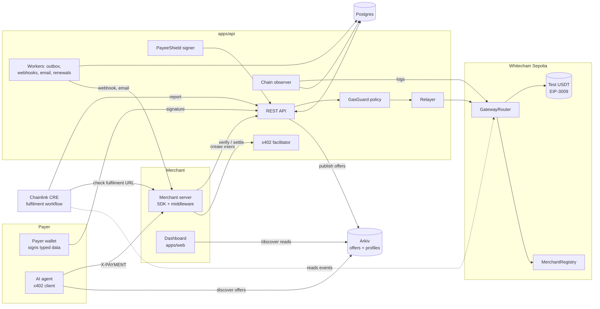
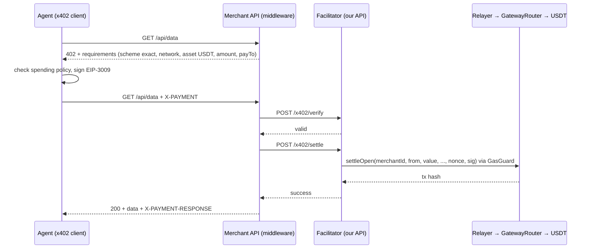
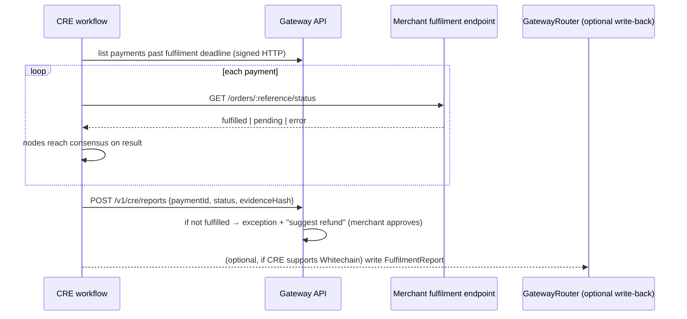

# 02 · Architecture

## 1. Principles

1. **Settlement lives on Whitechain; everything else is optional.** Arkiv and CRE are never on the critical path.
2. **Enforce rules in contracts, not in our server.** The server is helpful but not trusted for payout address, replay, or refund caps.
3. **Non-custodial.** No contract or account of ours ever holds customer USDT.
4. **One ledger for humans and agents.** x402 and checkout settle through the same router and appear in the same tables.
5. **Observe, don't trust.** Status comes from chain logs, not browser callbacks or RPC "tx sent" responses.

## 2. Component map



## 3. Responsibilities

| Component | Responsibility | Trust |
|---|---|---|
| `MerchantRegistry` | Merchant owner registers payout wallet and signer key; changes require the owner wallet | On-chain, authoritative |
| `GatewayRouter` | Executes `transferWithAuthorization` to the **registered** payout; binds nonce to intent; marks paid; enforces refund cap; emits receipts | On-chain, authoritative |
| Relayer | Pays WBT gas, calls only allowlisted router functions | Trusted for liveness only, not for correctness |
| GasGuard | Decides whether to sponsor a request | Server policy |
| Chain observer | Reads router/token logs, applies confirmation policy, updates status | Authoritative for off-chain status |
| PayeeShield signer | Signs invoice payloads with a per-merchant delegated key | Trusted issuer (see 08) |
| x402 facilitator | `/supported`, `/verify`, `/settle` for the x402 "exact" EVM scheme | Same relayer path |
| Workers | Outbox → webhooks and email with retries | Server |
| Arkiv publisher | Writes/renews profile and offer entities | Public data only |
| CRE workflow | Checks fulfilment endpoint, reports result | Decentralized execution; merchant endpoint is still merchant-controlled |

## 4. Flow A: one-time gasless checkout

```mermaid
sequenceDiagram
  autonumber
  participant M as Merchant server
  participant API as Gateway API
  participant C as Checkout (browser)
  participant P as Payer wallet
  participant R as Relayer
  participant GR as GatewayRouter
  participant T as USDT
  participant O as Observer

  M->>API: POST /v1/payment-intents (amount, reference)
  API-->>M: id, checkoutUrl, clientSecret
  M-->>C: redirect or mount widget
  C->>API: GET intent + PayeeShield payload
  C->>C: verify signature + fields (amount/token/chain/payout)
  C->>P: eth_signTypedData_v4 TransferWithAuthorization
  P-->>C: signature (no gas)
  C->>API: POST /authorize (signature)
  API->>API: validate intent, signature, window; GasGuard
  API->>R: settle(params)
  R->>GR: settle(intentId, merchantId, from, value, validAfter, validBefore, v, r, s)
  GR->>GR: payout = registry.payout(merchantId); nonce = H(intentId, merchantId, payout, value)
  GR->>T: transferWithAuthorization(from, payout, value, ..., nonce, v, r, s)
  T-->>GR: ok (USDT payer → merchant)
  GR-->>O: emit PaymentSettled
  O->>API: log seen, confirmations met → succeeded
  API->>M: signed webhook payment.succeeded
  API->>C: status + receipt
```

### Key design decisions

- **`to` is never a parameter.** The router reads the payout from `MerchantRegistry`. A malicious or buggy server cannot redirect funds.
- **Nonce binding.** The EIP-3009 nonce is `keccak256(abi.encode("SGv1", intentId, merchantId, payout, value))`. The payer signs a nonce that is only valid for that invoice. The router recomputes it and reverts on mismatch.
- **One-shot.** `paid[intentId]` prevents double settlement even if two valid authorizations exist.
- **Direct submission still safe.** If someone calls `token.transferWithAuthorization` directly with the same signature, USDT still reaches the merchant, but no router receipt is emitted. The observer therefore also watches the token's `AuthorizationUsed` and `Transfer` logs and reconciles by nonce.

## 5. Flow B: refund

1. Merchant clicks Refund (amount ≤ remaining). API computes `refundId` and the refund nonce `H("SGR1", paymentId, refundSeq, value)`.
2. Dashboard asks the merchant's **payout wallet** (EOA) to sign `TransferWithAuthorization(from=payout, to=payer, value, nonce)`. No gas.
3. Relayer calls `router.refund(...)`. Router checks `refunded[paymentId] + value ≤ paid[paymentId]`, `to == payer`, `from == payout used at payment time`, then calls the token and emits `RefundSettled`.
4. Observer confirms → `refund.succeeded` webhook + customer notification.

**Fallback (no merchant signature support):** merchant sends a plain USDT transfer from their wallet and pastes or auto-detects the tx; observer verifies it and records it as `manual_refund` (cap enforced off-chain only). The UI must label which path was used.

Limitation: payout wallets must be **EOAs** in the MVP (EIP-3009 with contract-wallet signatures needs ERC-1271 support that is not assumed).

## 6. Flow C: x402 (agent pays API)



- x402's standard EVM scheme uses a random per-payment nonce, so the router exposes `settleOpen` (no nonce binding to an intent), but the recipient is **still** taken from `MerchantRegistry`, and the facilitator verifies `payTo` equals the registered payout. *(Unverified: check the current x402 spec and `@x402/*` packages for exact field names and version.)*
- Agent policy (per-call cap, daily cap, allowed merchants) lives in the agent client; we ship a reference implementation in `apps/demo-agent`.
- **Do not fork** an existing Whitechain facilitator. Implement against the x402 spec.

## 7. Flow D: fulfilment check with Chainlink CRE



Details and honest limits are in [`../INTEGRATION.md`](../INTEGRATION.md) §3.

## 8. Flow E: Arkiv publish and discover

- **Publish:** when a merchant enables "list publicly" the API writes a `merchant_profile` and one `offer` per public item/x402 route. Each carries the merchant's PayeeShield signature over the listing. Renewal job extends expiry before it lapses.
- **Read:** `/discover` (web) and `GET /v1/discover` (agents) query Arkiv with filters (category, max price, kind). Before showing "Pay", the client checks `offer.payTo == MerchantRegistry.payout(merchantId)` and the listing signature. A tampered or stale listing is flagged.

## 9. State machines

### Payment intent
```text
created → requires_authorization → authorized → submitted → pending_confirmation → succeeded
                       ↘ expired                    ↘ failed
succeeded → partially_refunded → refunded
any → exception (reconciliation mismatch; on-chain record unchanged)
```
Rules: `succeeded` never goes backward. Webhook retries and stale client calls cannot regress state.

### Refund
`requested → authorized → submitted → succeeded | failed`

### Fulfilment (minimal)
`not_started → fulfilled | not_fulfilled(by CRE) | merchant_marked_fulfilled`

## 10. Confirmation policy

Whitechain's transaction lifecycle has multiple stages (fast soft confirmation from the sequencer, later "safe" and "finalized"). **Unverified exact timings for the testnet.** Proposed policy, configurable per merchant:

| Order value | Mark `succeeded` at |
|---|---|
| ≤ 100 USDT | N₁ block confirmations (default 3) |
| > 100 USDT | "safe" status or N₂ confirmations (default 30), whichever the RPC exposes |

UI shows `processing` until the threshold; webhooks fire only on `succeeded`.

## 11. Failure handling summary

| Failure | Behavior |
|---|---|
| Relayer out of WBT | Requests rejected with `RELAYER_UNAVAILABLE`; operator alert; circuit breaker |
| RPC down | Observer retries with backoff; no state regression; backfill by block range |
| Duplicate authorize request | Idempotency key + `paid[intentId]` → same result |
| Underpay / overpay / duplicate | Exception record + suggested action; no automatic refund |
| Webhook endpoint failing | Bounded exponential retries, delivery log, manual replay |
| Arkiv down | Checkout unaffected; `/discover` shows cached or degraded state |
| CRE unavailable | Fulfilment stays `unknown`; no payment impact |
